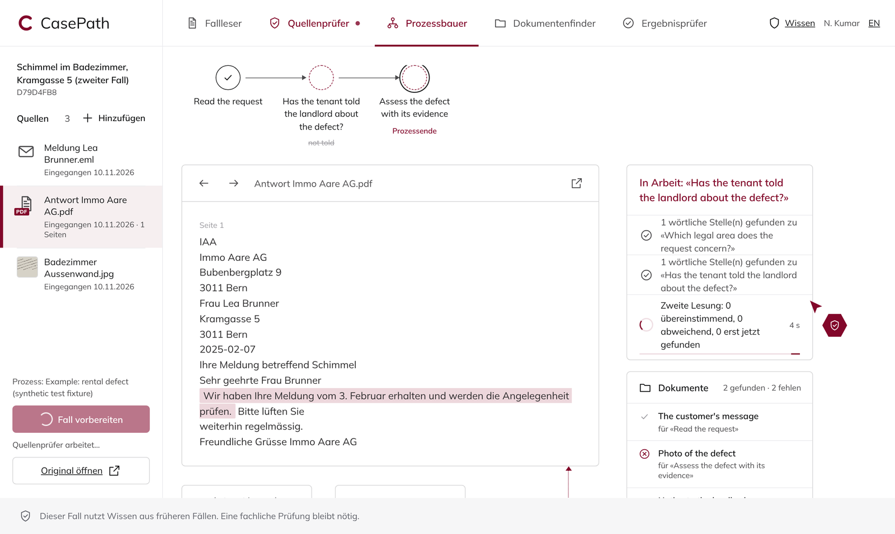
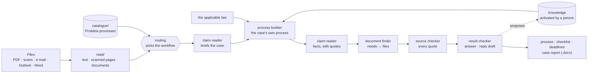
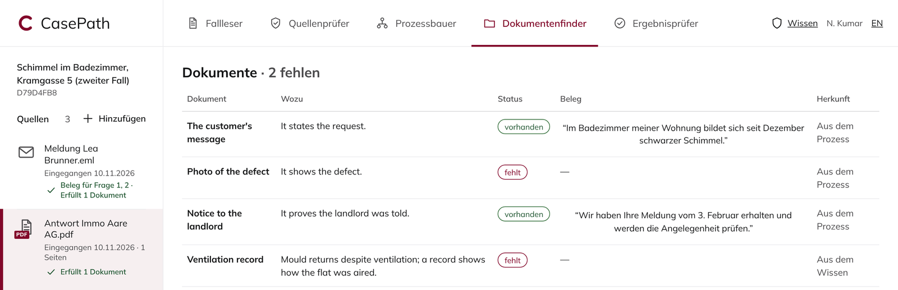

# CasePath

Agents prepare a legal-protection case from its files. A person decides.





Each fact and each document rests on a quote found word for word in the file, and the source checker checks every one. A document the law requires shows its article.



## Run

```sh
make setup      # .venv with the dependencies
make test       # every test; no network, no model
make preview    # http://127.0.0.1:8790: synthetic cases, scripted model
```

## Ship (Databricks App `casepath-pilot`)

```sh
make package    # → build/casepath-app/
```

Upload `build/casepath-app/` to the workspace. Fill in the three `FILL-IN`s in its `app.yaml` there, never in Git, then deploy. `GET /api/health` answers `"status": "ok"`. Details: [docs/DEPLOYMENT.md](docs/DEPLOYMENT.md).

## Map

```
casepath/              python -m casepath <command>   (no command: the list)
  read/                files → text, page images, documents, quotes (PDF, fax and Outlook readers on the standard library)
  agents/              lead, five agents and their plan (team.py); one job in, one outcome out (core.py); model clients
  process/             workflows, each case's own process, Knowledge; areas/: the handler's backbone and one module per legal area (docs/AREAS.md)
  web/                 API (app.py), case store, sign-in, volume, case report, workspace (ui/)
  quality/             benchmark, evaluator, synthetic cases, content-free scorecards
  config.py            every setting, from the environment
catalogue/             Protekta's processes as workflows (JSON)          internal copy
benchmark/             synthetic cases with known answers                internal copy
deploy/                databricks/ · workspace/ (DSW) · preview/ · cloudshell/ · Dockerfile at the root
docs/                  HANDLER_BAR.md (what done means) · DEPLOYMENT.md · contracts/ (case API) · history/
tests/
.gitlab-ci.yml         the DSW's pipeline (+ mobi.yaml, renovate.json)   internal copy
```

## Rules

- A fact counts only with a quote found word for word in the file.
- Case content stays inside Mobiliar. Anything that leaves is a content-free count.
- Knowledge reaches a case only after a person activates it; each use names its version.
- A run stops at its token budget (`CASEPATH_RUN_TOKEN_BUDGET`) and says so.
- Text in a file that addresses an AI is flagged, never followed.
