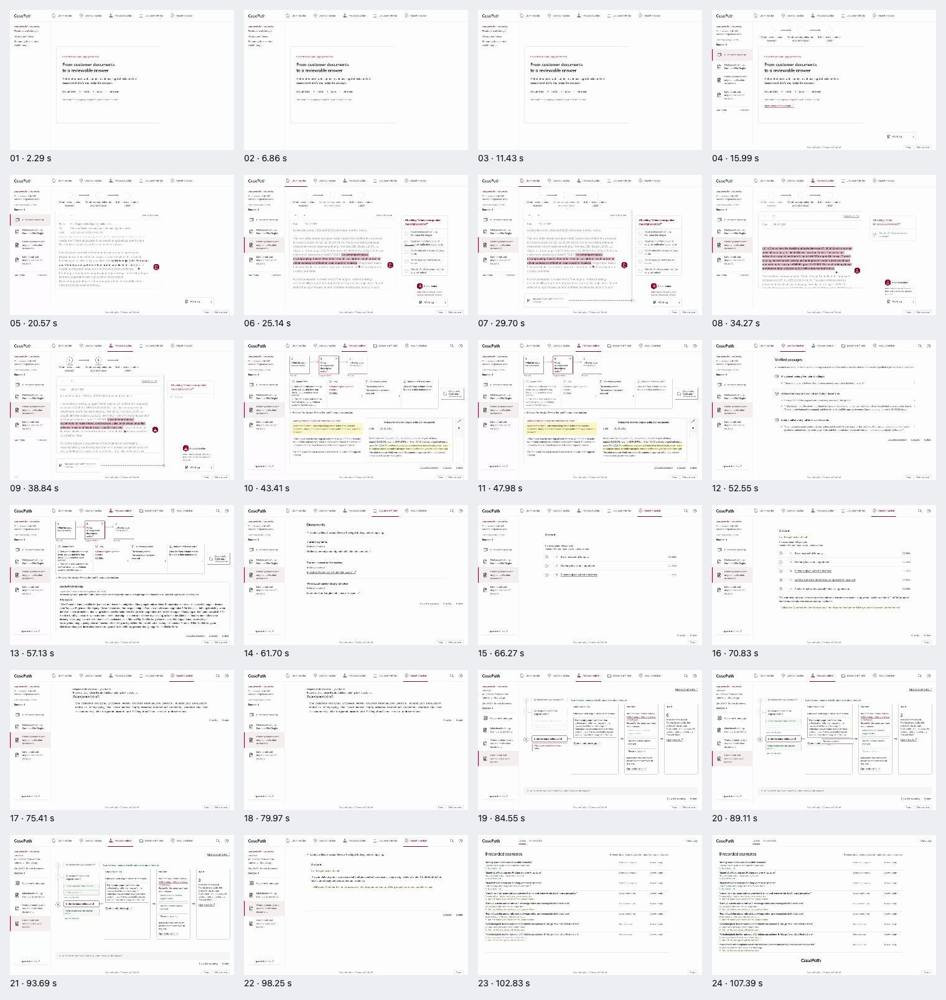

# CasePath demo polish — completed release evidence

**Tested and deployed source: 4864e7347c299bf1b580a5b35667635bc1c47f15. Sites version 49.**

[Public presentation](https://casepath-autonomous.kumarnavish.chatgpt.site/?present=1#autonomous/demonstration) · [Presenter and restart runbook](demo-operator-guide.md) · [Machine acceptance](release-acceptance.json) · [Hash index](evidence-manifest.json)

The public presentation explains its purpose while recorded cases are admitted, then starts automatically. The receiving-case Result checker presents the historical Before/After comparison immediately, with an optional disclosure for the full 12-node process and an ordinal marker for the affected step. These changes use the existing source, journal and saved-version authority.

The receiving case retains its own **30. Juni** and **31. Juli** notice passages and exact saved version 1, even though the source library also contains version 2. **Compare both complete notices** is the additional prerequisite. **Preserve challenge or extension deadline** remains the next protective action. The original evidence connection is retained. These are engineering observations from fictional cases; they do not authorize a claim outcome.

## Completed verification

| Evidence | Actual result |
|---|---|
| [Complete official gate](release/full-gate-verified.json) | 2,927 passed; 10 exact historical skips; zero failures, errors, deselections or new skips |
| Mandatory frontend coverage | All 18 declared suites required |
| [Final standalone operator recording](sealed-browser-command.json) | After the completed full gate and the reporter correction, the unchanged review journey was recorded again with explicit TAP output; its actual Commander terminal completed with exit 0 |
| [Published acceptance](release/published-acceptance-sequence.json) | Actual Commander terminal completion with exit 0 |
| [Read soak](release/published-soak-4864e734/summary.json) | 300/300 reads succeeded; zero soak 503s; zero runner retries or initiated provider calls |
| [Published browser](release/published-browser-4864e734/summary.json) | 18 desktop and 9 mobile views; source identities, loaded assets, original-source delivery, overflow and write checks passed |
| Continuous public film | Six acts, 88.05 seconds, 4× indicator observed, actual end reached |
| [Cold-opening inspection](opening-published-4864/receipt.json) | Admission observed after 21,297 ms; separate inspection paused at admission; no application writes or browser errors |
| [Primary source preservation](release/readback-verified.json) | 159 claims; collection, knowledge and ledger unchanged; 42 existing provider calls; original nine workflows were not repeated |
| [Public original image](release/public-image-verified.json) | Exact 201,417-byte original JPEG; local Pillow 13.0.0 decoding verified |
| [API build](release/api-build-version.json) | Actual hosted installation log includes Pillow 13.0.0; server-side image decoding is not claimed |
| [Engineering promotion](release/engineering-promotion-verified-4864.json) | Existing port-4194 store, original QA ancestry, current data and process views preserved while source advanced |
| [Standard promotion](standard-promotion/cp-polish-standard-20261024-01/verify/receipt.json) | Existing port-4173 data/provenance preserved; exactly one native boot appended to the original immutable lineage |

## Actual film and visual review

The [continuous public recording](release/published-browser-4864e734/public-walkthrough.webm), [24 decoded frames](release/public-film-review/frames-index.json), and [independent assistant review](release/public-film-review/cold-viewer-review.json) describe the same video bytes. The samples span the actual recording, including loading time; no exact video-PTS-to-browser-clock mapping is claimed.

**Purpose understood:** CasePath helps a legal-protection case reviewer turn customer documents into a traceable legal assessment and an unsent draft. The opening explains Documents → Facts → Law → Answer and says the reviewer makes the decision. The detailed rent-increase example organizes received sources, questions and legal tests, links facts to original passages and the legal basis, produces a bounded draft for review, and demonstrates a reusable checklist. The final list suggests additional defects/repairs and lease-termination examples.

**Mechanism understood:** The film reads received material and highlights a relevant source passage, organizes the review into three questions, connects those questions to facts, law, evidence and a reference checklist, and checks quoted passages against received files and recorded evidence rules. It displays article 269d and a five-test result with missing original reasons as the failed test. The unsent draft distinguishes the finding from questions left undetermined. A later-case sequence applies three saved document checks while explicitly using the later case's own facts, documents and dates; the reusable asset is a checklist rather than the earlier factual conclusion.

**Value understood:** The visible value is less manual reconstruction and a more inspectable basis for the reviewer's answer: the reviewer can move from a question to the supporting passage and legal test. The film distinguishes complete document inventory from satisfaction of a legal requirement, and shows consistent checks reused while each case's evidence is examined separately. Unresolved issues and the unsent draft make the assessment's scope understandable. These are qualitative demonstrated benefits, not measured time savings or accuracy gains.

**Remaining clarity observations:** The public film does not show the original creation, editing, validation or saving of its reusable checklist; its reference-case title differs from the first detailed example, so the viewer would not infer that the system learned a new checklist from the case just watched. Real intake, correcting a misread fact, overriding a check, editing a draft and completing approval are not demonstrated in these public frames. Rule definition, legal-source maintenance and conflict handling are not explained. Dense evidence/law panels and mixed English/German require concentrated reading; work on the second question appears before completion of the first. The first three sampled frames still show preparation at 2.285, 6.855 and 11.425 seconds, and the film ends with a nine-case list rather than a concise recap. These gaps reduce operational depth and momentum but do not prevent understanding the core purpose, evidence trail, checklist reuse or human decision boundary.

The [eight state images](release/eight-state-capture/eight-state-evidence.json) combine six fresh read-only public presentation observations with two exact screenshots from the standalone deterministic operator recording completed after the gate. States 7–8 are explicitly **Test handler engineering QA**. Numeric fidelity measurements are retained separately from the root-authored visual review.

| Concept | Measured pixel difference | Actual reviewed deviation |
|---|---:|---|
| 01-decision-building.png | 4.7300% | The side-by-side, overlay and difference images preserve the intended source rail, role bar, focused document, exact highlighted passage, fact card, dotted source connection, work panel and work-log placement. The live rent-increase case has four source entries and three actual review questions rather than the concept's seven sources and six heating-related questions. Its focused fact card and active Claim reader role reflect the captured operation; text, source content and vertical positions therefore differ. I inspected states 1–5 individually: the purpose, source passage and source-to-fact connection are legible and contained in the desktop viewport. These are case-specific, truthful differences rather than missing evidence controls. |
| 02-completed-process.png | 6.0500% | The completed live process keeps the concept's question graph, evidence/law/reference inspection, document status and original-source reader. The rent-increase graph contains three real questions, four evidence columns and zero missing files rather than the concept's larger branching heating graph and missing-evidence count. The failed legal requirement is explicitly red while evidence completeness remains separately stated. The selected quotation is readable beside the original source, with zoom/full-source controls. Source text, graph density and panel heights differ because this is the admitted case's actual state. The individual state-6 capture has no obscured main conclusion or horizontal clipping. |
| 03-reviewed-memory-payoff.png | 4.6700% | The live receiving case makes the historical Before/After dependency change and exact saved version immediately visible, followed by the case's own two source passages, reviewed-version provenance and current consequence in three cards. The full 12-step process is available through a disclosure instead of the concept's permanently expanded vertical graph; the affected step is correctly numbered 11 in the rendered process. The new prerequisite remains waiting, the protective deadline action stays unchanged, and the original evidence relationship is retained. An original-document reader and the explicit Test handler/qualified-review boundary replace the concept's illustrative expert-review claim. I inspected states 7 and 8 separately; the source editor's PDF continues in its normal reader below the visible section, while the later-case comparison, source links and next action fit together at 1440×900. These differences improve the actual case's clarity without asserting claim approval. |

[Nine comparison images and measurements](release/northstar-fidelity/fidelity-measurements.json) · [Root visual review](release/northstar-fidelity/visual-review.json)

## Preseal chronology

The [earlier combined development command](preseal-candidate-command.json) predates the final opening-rail adjustment. Its source hashes remain as originally observed. The [final opening command](preseal-opening-final-command.json) separately binds the final nine application and test files, admission regressions and five visual captures. The separately reviewed plan is included in the ten-file authored source binding. The completed full gate then covers the sealed release. Earlier evidence is not relabeled as a complete test of later bytes.

The invalid-state mobile capture records that the full purpose text extends below the viewport during ordinary vertical scrolling; its recovery controls remain visible. The [root-authored preseal visual review](preseal-visuals.json) retains that observation rather than rewriting the geometric result.

## Recording evidence after the completed gate

The complete application gate passed with all mandatory frontend suites. The official launcher did not forward the review artifact-directory and video environment flags, so the gate did not retain the expected recording files. The subsequent export/adoption attempt failed because its required receipt was absent. Its [actual failed terminal](release/commander-adoption-failed-terminal.json) and the [root diagnosis](release/browser-evidence-recovery.json) are preserved.

The first standalone browser test completed with child exit 0, but Node emitted its default spec summary and the wrapper's TAP parser rejected it. That parent process failed with exit 1. Its [actual failed terminal](release/commander-capture-reporter-failed-terminal.json), [unchanged command receipt](capture-attempts/spec-reporter/sealed-browser-command.json), [exact log](capture-attempts/spec-reporter/sealed-browser-capture.log), and [original runner](capture-attempts/spec-reporter/run_sealed_browser_capture.py) are preserved. Its duplicate media and private fixture remain in the runtime archive and are not included in this bundle.

The runner was then corrected only to request explicit TAP output. The same unchanged browser journey was recorded again in a fresh isolated directory. The final recording's [command and artifact hashes](sealed-browser-command.json), [complete log](sealed-browser-capture.log), [runner](run_sealed_browser_capture.py), and [actual successful terminal](release/commander-sealed-browser-terminal.json) establish the bundled media's origin. The full application gate was not repeated. The original adopter and both earlier packaging templates remain preserved as historical helper source.

The initial API build-log proof also encountered a CLI compatibility error: the installed command does not accept the supplied --app-id option. Its [failed terminal](release/commander-api-build-proof-failed-terminal.json) is retained. The [corrected read-only verifier](release/verify_api_build_v2.py) removed that unsupported argument and then completed successfully, as shown by its [actual terminal](release/commander-api-build-proof-terminal.json) and [version proof](release/api-build-version.json). This correction read the existing deployment's build log; it did not repeat the API deployment.

## Qualification and evidence scope

**Qualified human approval remains pending.** The assistant cold-viewer review, root visual review, typed Test handler actor and automated gates are engineering evidence. [The source-bound operator review](../../northstar-review-20261024/OPERATOR_REVIEW.md) identifies the substantive decision still required before accepting the exact reusable prerequisite for real use.

The two local workspaces keep their separate original stores. Disposable data from the gate and standalone recording is not used as the ancestry of the retained engineering store. Current QA edits are preserved; neither promotion restores a historical 164-event screenshot state.

This bundle contains explicit evidence files, exact recordings/images, safe hashes and runtime helper source. It excludes private seed bytes, complete collection readbacks, full historical policy/budget records, full corpus copies, credentials and native boot payloads. The [selected baseline summary](baseline-preservation-summary.json) contains only six top-level identity/preservation fields and the original binding-file hash. Raw fresh public response bodies are validated in the runtime and represented here by their receipt hashes. This generator creates no Git commit, push, deployment or product-source change.
