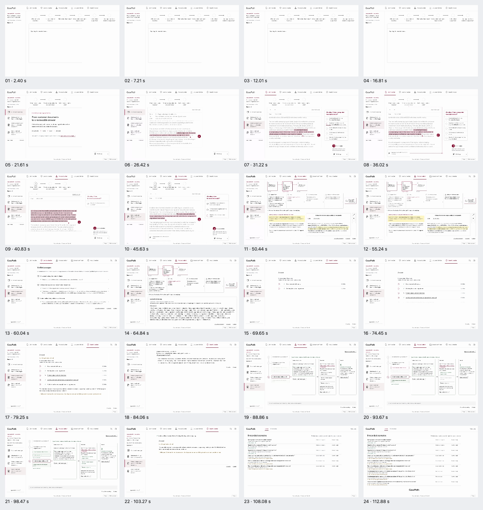
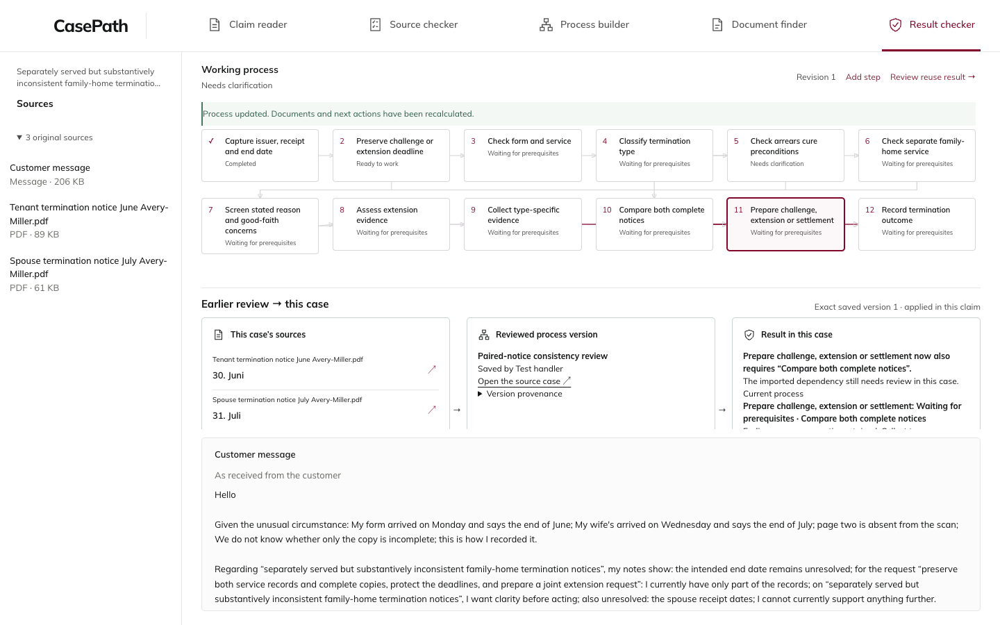
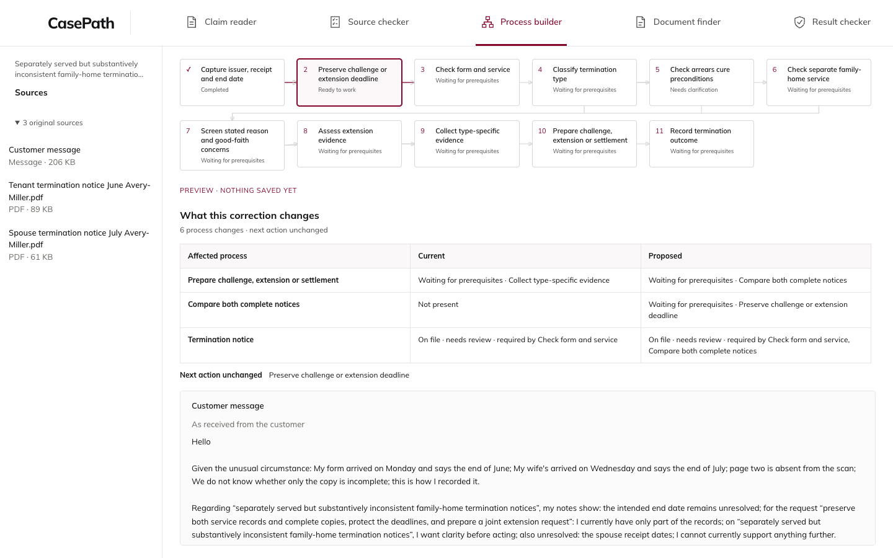

# CasePath north-star review journey — verified engineering release

**Tested and deployed source: b20685d1670b33b941b1bfcb902638a879c01b93. Sites version 48.**

[Public CasePath](https://casepath-autonomous.kumarnavish.chatgpt.site) · [Recorded presentation](https://casepath-autonomous.kumarnavish.chatgpt.site/?present=1#autonomous/demonstration) · [Two-case presenter guide](demo-operator-guide.md) · [Recorded operator walkthrough](review-walkthrough.webm)

This evidence-only child commit records actual completed checks and deployment. It changes no sealed product file. The API and Site identify the tested source above; the later integration HEAD adds this handoff.

## What is now implemented

The local operator workspace keeps the original source reader and the working process graph together. Its five roles use the existing claim authority. An operator can select a graph step, edit a decision, inspect real before/after effects before saving, validate a selected structure, save an exact fragment version, and explicitly apply that version in another case.

The receiving case exposes its own source dates alongside the saved version and the actual added prerequisite. It keeps its own facts, original source bindings, held-document review states and earlier process connections. A newer source version does not silently replace the saved pin. Stale preview, claim-navigation and accepted-save races are guarded; accepted saves recover by reading current authority, without replaying a POST.

The public demonstration remains read-only. The editable completed example is an isolated engineering copy on the owner's Mac; its recorded actor is **Test handler**. It is not a human or expert approval.

## The demonstrated consequence

Both original cases contain a tenant notice stating **30. Juni** and a spouse notice stating **31. Juli**. The original scans and messages remain the evidence. A missing page in a scan does not establish that the original served notice was incomplete.

The QA correction adds **Compare both complete notices** as a prerequisite of **Prepare challenge, extension or settlement**. Resolution was blocked before and remains blocked afterwards. The added prerequisite changes the dependency and the notices' required-step associations. **Preserve challenge or extension deadline** remains the next action; document request timing is unchanged. The earlier evidence connection remains in the graph and cannot be bypassed by completing only the new prerequisite.

The receiving case must still review the imported dependency. Process validation does not authorize the claim outcome. [The source-bound operator review packet](../OPERATOR_REVIEW.md) sets out the remaining qualified judgment.

## Fresh verification

| Check | Observed result |
|---|---|
| Complete sealed gate | 2,927 passed; exactly 10 historical skips; no failures, errors, deselections or new skips |
| Frontend gate | All 18 declared suites mandatory, including the complete operator browser journey |
| Source seal | 1,746 source files verified before and after; clean tested checkout |
| Sealed operator walkthrough | Actual source-bound terminal exit 0; four screenshots and video; no browser errors or unexpected destinations |
| Review semantics | Source/target facts and bindings preserved; exact version 1 retained after version 2; preview adds no event; outcome authority remains false |
| Repeated-use recovery | Result role and current consequence survive reload; accepted-save and stale-preview race regressions included |
| Mobile operator view | 390 × 844; no document/page overflow; reduced motion enabled; no running animations |
| Published read soak | 300/300 reads; zero 503s; 300 primary and 0 last-verified responses; 7 extra identity/readback checks |
| Published browser | 18 desktop and 9 mobile case views; all observed assets byte-verified, required initial assets present, both new review assets fetched and verified |
| Public presentation | Complete 88.05-second six-act playback; source, law, keyboard, draft and reduced-motion checks |
| Existing API compatibility | Built wheel contains the exact private seed and requires Pillow 13.0.0; deployed original JPEG matches its sealed bytes |
| Final primary readback | Matching API/Site source; case collection, Knowledge and complete reported usage/budget state unchanged |
| Local demo handoff | Exact QA pin/event verified; fresh data copy; startup and read-only smoke append no review event |
| Restart rehearsal | Owned first process fully stopped; existing QA data reopened under a new boot ID; both journals and both case views unchanged |

The highest per-route p95 in this sequential soak was 1.454s; the maximum was 2.290s. These measurements describe this run. The historical skips remain explicit in the full-gate receipt.

All 159 intakes remain, with 42 total reported provider calls. The original nine saved investigations and their 18 provider calls were not repeated. The reported cost remains unchanged. The usage comparison covers the complete status.limits projection; it does not claim a raw ledger-row comparison.

## Eight states, motion and visual evidence

[Eight-state evidence](eight-state-evidence.json) binds six deterministic inspections of the actual public recording and two screenshots of the actual sealed operator run to this source. The accepted process question links to at least two distinct recorded facts. The preserved W10/W11 film shows the current source-matched fact one at a time; the underlying operation history retains the earlier contributors.

[The continuous public film](public-walkthrough.webm) was recorded at 1440 × 900. [The 24-frame index](frames-index.json) identifies evenly spaced frames decoded from that finalized video, including its actual opening and end. They are distinct from the deterministic state stills. [The fresh cold-viewer response](cold-viewer-review.json) records the four required answers without project-history context. [Motion evidence](motion-evidence.json) maps the completed strict gate to its recorded source, cursor, role and 5,283-frame geometry checks.

[Concept measurements](fidelity-measurements.json) and [the inspected deviations](fidelity-review.json) accompany the three side-by-side/overlay/difference sets. A pixel difference is a measurement, not a semantic acceptance score. No unresolved visual deviation remains in that review; qualified substantive review remains separate.

## What still requires a person

Engineering coverage of all eight stage categories is verified by recorded presentation evidence and the isolated Test handler correction/reuse run. Literal state 8 still requires qualified human approval of the exact reusable version. A qualified reviewer must decide whether this additional notice-comparison prerequisite, its scope and completion criterion are appropriate for reuse, while preserving protective actions and deadlines. No automated test, typed actor name or green process marker supplies that judgment.

## Recovered checks and retained observations

The first evidence-only eight-state capture stopped because it compared live operations against an older fixture from a different journal/reuse context. The original failed sequence, terminal result, log and four captured states remain in this packet. The recovery uses actual served claim states and complete live operation histories, verifies all 856 operations with the unchanged application validator, and checks every stream hash and final binding. The recovered capture must match those independently captured live bytes. No chain hash was discarded to make a comparison pass.

The standard local launcher initially rejected generated Python bytecode outside its sealed dependency roster. All 4,147 recorded entries were unchanged. The 179 generated extras were quarantined, the unchanged exact-closure validator passed, and the original boot receipt remained intact. Both local servers then passed the GET-only handoff. The earlier restart probe that ran before readiness and the incidental diagnostic browser/HTTP failures are also retained and classified.

The independent assistant cold viewer accepted purpose, mechanism and value without a briefing, while noting the temporary opening-case/loading screen, dense legal text, and limited explanation of checklist construction. This is an assistant visual assessment, not a human approval. Open the public link and wait for its introduction before presenting; pause on evidence or law when explanation is needed. The local review journey supplies the separate direct-edit/save/reuse demonstration.

## Evidence

[Release identities](release-acceptance.json) · [Full gate](full-gate.json) · [Complete gate log](full-gate.log) · [Actual gate completion](gate-actual-completion.json) · [Independent review](independent-review.json) · [Operator receipt](review-browser-receipt.json) · [Published acceptance](published-acceptance-sequence.json) · [Soak](published-soak-summary.json) · [Browser](published-browser-summary.json) · [Detailed browser evidence](published-verification.json) · [Primary readback](readback-verified.json) · [Reviewed diagnostics](diagnostics-reviewed.json) · [Hash index](evidence-manifest.json)

