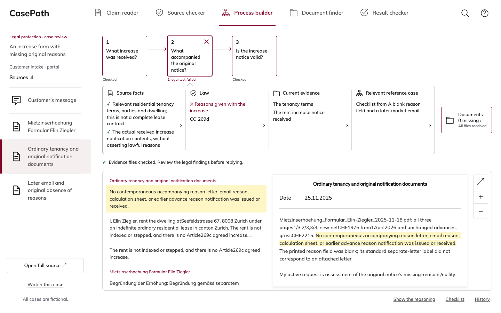

# CasePath final demo acceptance

**Tested and deployed source: 143ff3ccf2068a2aeae51f47fef405269e131312.**

This bundle is added by a separate evidence-only child commit. The integration branch HEAD after that commit is an evidence revision. The API and public site serve the tested source above. Product bytes are unchanged by this evidence commit.

[Open CasePath](https://casepath-autonomous.kumarnavish.chatgpt.site) · [Autoplay presentation](https://casepath-autonomous.kumarnavish.chatgpt.site/?present=1#autonomous/demonstration) · [Presenter walkthrough](demo-operator-guide.md)

## Recovered and completed work

The interrupted work was recovered from Codex thread 01a15ae9-3851-79b2-9d1b-af0b75f25a86. Original checkouts and failed or interrupted evidence remain preserved. The reliability changes add bounded transient-read retries, exact last-verified projections, row-neutral read-only startup, and one bounded browser retry followed by manual recovery.

The intermediate a6f90100 release passed its checks. Later screenshot inspection found mobile source names overlapping their Received labels. Source 143ff3cc gives the filename and status separate mobile layout columns. JavaScript and the recorded presentation remain unchanged from a6f90100. Every final gate below ran freshly against 143ff3cc.

## Completed verification

| Check | Result |
|---|---|
| Full strict suite | 2,891 passed; 10 unchanged historical skips; zero failures, errors, deselections or new skips |
| Frontend suites | All eleven mandatory |
| Source integrity | 1741 manifest-listed files exact; protected files unchanged |
| Film equivalence | 5,283/5,283 frame hashes matched; six exact live image comparisons |
| Local browser walk | All seven scripts through nine reference cases |
| Local mobile layout | 27 case views and 81 document rows at 320, 390 and 700 pixels |
| Published read soak | 300/300 successful sequential reads; zero 503s; 300 primary and 0 last-verified responses |
| Published browser | 18 desktop and nine mobile case views; 27 mobile document rows; served assets matched |
| Published presentation | 88.05 seconds, all six acts, zero product errors or writes |
| Final primary readback | API and site identify 143ff3cc; collection, Knowledge and complete reported usage/budget state unchanged |
| Visual inspection | Published desktop and mobile screenshots inspected and retained below |

The soak includes seven additional identity/readback GETs, zero runner retries and zero initiated provider calls. Across its six routes, the highest p95 was 1.320 seconds and maximum observed latency was 2.289 seconds. These are sequential verification measurements.

There are 159 intakes: 150 canonical intakes and nine additional native intakes. Nine selected original cases have saved investigation histories. The nine curated reference examples are a separate selection with one shared case. The original nine workflows and their 18 provider calls were not repeated.

## Live release and proof

Sites version **46**, distribution commit **14aacce1a8be46bd125da7a777dac47fb89a7490**, serves source **143ff3ccf2068a2aeae51f47fef405269e131312**. The API reports that same source with remote_primary, read_only=true and writable=false.

[Release acceptance](release-acceptance.json) · [Full gate](full-gate.json) · [Live acceptance sequence](published-acceptance-sequence.json) · [Soak](published-soak-summary.json) · [Browser](published-browser-summary.json) · [Primary readback](readback-verified.json) · [Evidence hash index](evidence-manifest.json)

The hash index distinguishes unchanged receipt copies from derived summaries and retains original runtime receipt paths and hashes. The readback receipt's ledger_unchanged field compares the complete reported status.limits object, including policy, grants and aggregate usage/budget values; it does not compare raw ledger rows.

## Demonstration scope

This is a recorded demonstration of fictional cases. The public workspace reviews and replays saved work. It does not start investigations or send drafts. Draft edits stay in the current browser; View original preserves the saved local copy.

Replay timing does not measure live model speed, accuracy or time savings. Quotations preserve original extraction quality. A human Knowledge approval lifecycle is not demonstrated. Hosting can sleep; rehearse the presenting routes before the meeting. Server fallback responses require a matching validated copy and are distinguished by their response header and recorded in the soak evidence. If a browser refresh fails, a retained copy can remain visible with a saved-copy status.

