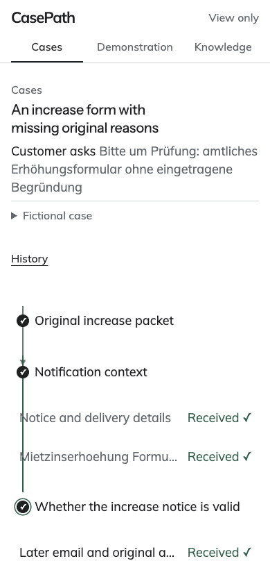

# CasePath verified demo — Pillow security maintenance

**Tested and deployed source: f6b1a9c201f7014d25e0573fa0d204c104894d42. Sites version 47.**

[Open CasePath](https://casepath-autonomous.kumarnavish.chatgpt.site) · [Play the presentation](https://casepath-autonomous.kumarnavish.chatgpt.site/?present=1#autonomous/demonstration) · [Presenter walkthrough](demo-operator-guide.md)

This evidence-only child commit records the completed release. It changes no sealed product file. The API and Site serve the source above; the later integration HEAD contains this handoff.

## What changed

All three dependency pins now require Pillow 13.0.0, the upstream fix for [GHSA-8g5g-8vmr-9782](https://github.com/python-pillow/Pillow/security/advisories/GHSA-8g5g-8vmr-9782). The source changes leave public UI assets unchanged.

Independent review found a compatibility regression: the native workspace rejected an older immutable image receipt solely because its recorded decoder version differed. The reviewed fix permits only the recorded 11.3.0 → current 13.0.0 transition for verified, exact-original JPEG/PNG receipts. All other fields must match. Hashes, dimensions, format, renderer identity, unknown version transitions and downgrades remain checked; journal history is never rewritten.

## Fresh verification

| Check | Result |
|---|---|
| Complete sealed gate | 2,919 passed; exactly 10 historical skips; zero failures, errors, deselections or new skips |
| Frontend gate | All 11 suites required, including the Mac cold-landing browser check |
| Source seal | 1,741 files verified; clean tested checkout |
| Existing image/hosted compatibility | 63 tests passed before and after the dependency update |
| Native continuation and integrity checks | 26 passed after reproducing and fixing 4 continuation failures; 20 new native regression cases |
| Targeted JPEG decoder probe | Both lossless-JPEG scaling cases rejected; valid full decoding, ordinary JPEG scaling and CasePath previews passed |
| API packaging | Built wheel requires Pillow 13.0.0 and contains the exact private read seed |
| Published soak | 300/300 reads; zero 503s; 300 primary and 0 last-verified responses; 7 extra identity/readback checks |
| Published browser | 18 desktop and 9 mobile case views; served assets verified; no product errors or mutating product requests |
| Presentation | Complete 88.05-second, six-act playback |
| Published original image | Exact 201,417-byte JPEG and sealed SHA-256 matched; downloaded bytes decoded with local Pillow 13.0.0 |
| Final primary reads | API and Site identify this source; collection, Knowledge and complete reported usage/budget state unchanged |
| Visual inspection | Current desktop and mobile screenshots inspected and retained |

The highest per-route p95 in the sequential soak was 1.267s; the maximum was 2.954s. These measurements describe this verification run.

The lossless-JPEG probe was not ASan-instrumented. Historical-version continuation tests simulate the recorded 11.3.0 provenance label while using the installed decoder; the separate before/after compatibility run exercised both installed versions. The public image download serves original bytes and does not invoke a server-side Pillow decoder.

The prior 5,283-frame visual comparison belongs to source 143ff3cc and remains [historical evidence](../commander-final-143ff3cc/README.md). It was not rerun for this maintenance change. Public source assets stayed exact, and this release received fresh frontend, live browser, presentation and screenshot verification.

## Preserved state and demonstration scope

All 159 intakes remain: 150 canonical intakes plus 9 additional native intakes. The original 9 saved investigations and 18 original provider calls were not repeated. The total reported provider-call counter remains 42 and the reported usage/budget state is unchanged. The readback comparison covers the complete status.limits projection; it does not claim a raw ledger-row comparison.

This is a recorded demonstration of fictional cases. The public workspace reviews saved work. Draft edits stay in the browser; they are not sent. Follow the presenter walkthrough to rehearse the routes before a meeting.

Known historical test skips remain explicit. This release fixes the demo's Pillow dependency; it does not claim the repository's unrelated security-alert backlog is closed or that the default branch has been promoted.

## Evidence

[Release identities](release-acceptance.json) · [Full gate](full-gate.json) · [Independent review](independent-review.json) · [Decoder probe](lossless-jpeg-probe.json) · [Live acceptance](published-acceptance-sequence.json) · [Soak](published-soak-summary.json) · [Browser](published-browser-summary.json) · [Primary readback](readback-verified.json) · [Image](public-image-verification.json) · [Reviewed diagnostics](diagnostics-reviewed.json) · [Hash index](evidence-manifest.json)

