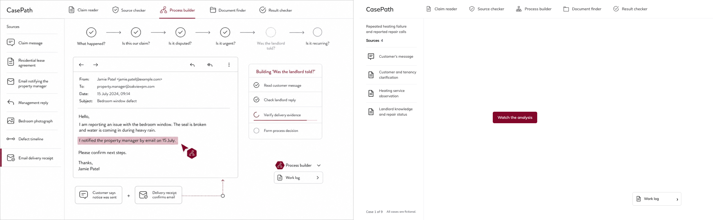
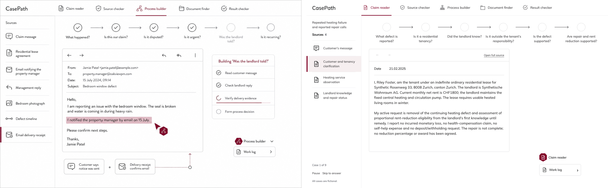
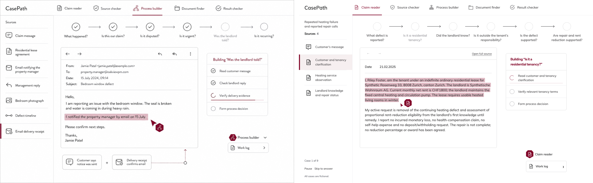
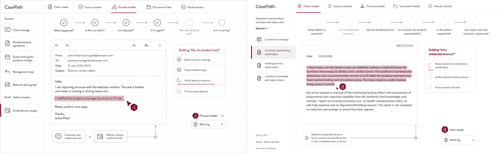
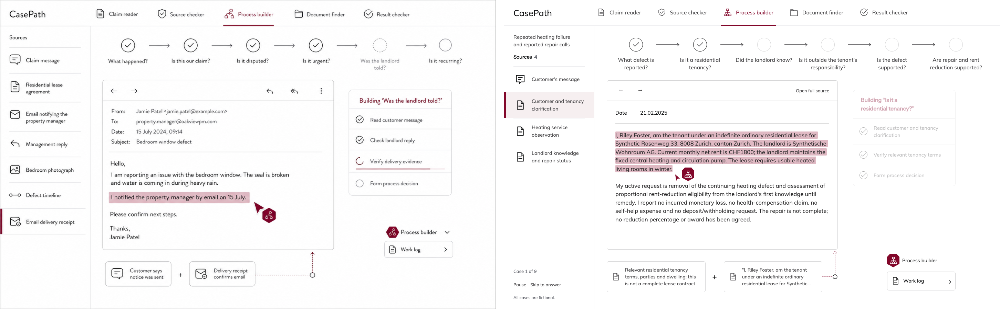
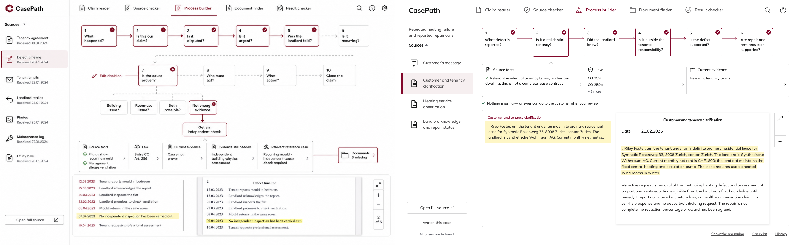
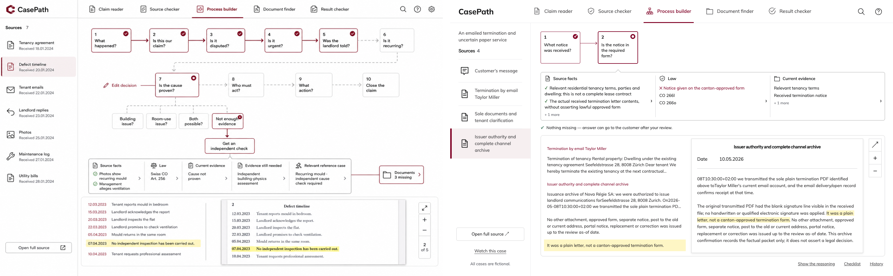
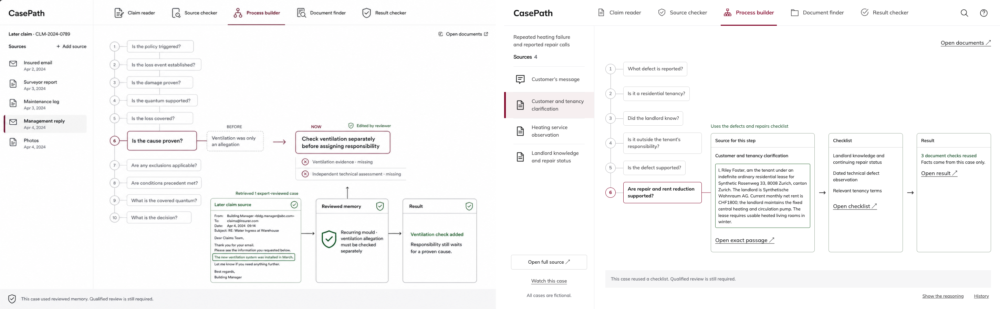
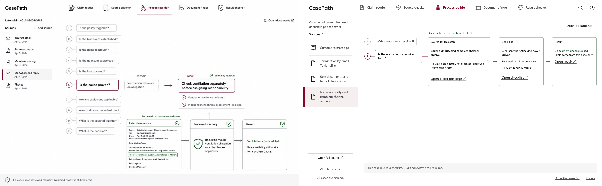

# Current UI finish receipt — W11, final UI handoff

The user authorized W11 as the final UI item, superseding `60d4907ca5c975e288fa3c0973992abd31fcc594`. The live checklist fits its rows, collapses only completed work when necessary, and spins only for the operation playing. A source-bound test audits all 5,283 film frames for row, fact-card and label clipping/overlap across all six acts. [The full W11 review](../../design-plans/w11-20261023/REVIEW.md) includes the fresh film, cold-viewer response, fidelity pairs, deliberate differences and limits.

Capture source `f777df0e05895207668540dcb5c01bddd6f4b544` is bound to the final tested source through unchanged application/API/QA/fixture/tool and served asset bytes. Acceptance requires [the original final-gate receipt](../../design-plans/w11-20261023/final-gate/verification.json): all eleven frontend suites, the protected Mac-owned test, one clean seven-script nine-case walk, zero console errors/writes/overlaps and complete cleanup. Missing or failed receipts do not establish READY. The final comment names the sealed tested SHA separately from the evidence-only commit.

The user authorizes integration and PR21/PR36 updates. The Mac owner retains release. No deployment, original-nine rerun, inference, provider/ledger writes or spending is authorized by W11. The original-nine grant was consumed, 18/18 calls; no remaining allowance exists.

“Before any call, the Mac integration owner checks the ledger to confirm this allowance is still available. This receipt grants no new allowance or retry.”

After the verified final UI handoff, no further UI changes are permitted except defects the Mac owner reports on PR21. Prior receipts below are retained as history.

---

# Current UI finish receipt — W10

W10 follows [PLANNER 6350440684](https://github.com/KumarNavish/casepath/pull/21#issuecomment-6350440684), the Mac handoff and the direct human instruction “Use self-review, then all final gates.” The existing writer owns `mac/casepath-cold-landing-20261022`; the Mac owner retains integration and release. This follow-up supersedes `5f254a9` for review without disturbing its release.

The complete [W10 evidence and self-review](../../design-plans/w10-20261022/README.md) binds captured source `48ec153d869e39afa64c8f04e358b72e5dea255a` to the final tested source. W10 uses the richest recorded case, readable exact source spans, the neutral fact glossary, cursor/connector cues and recorded checklist transfers into the later case. The fresh cold review recognizes the learning effect. [Fidelity](../../design-plans/w10-20261022/final-proof/fidelity/fidelity.json) has no pending deviation. Neutral question-completion markers deliberately replace affirmative checkmarks after cold reviews found them misleading. The actual failed legal test retains its crimson cross.

Final acceptance requires [the original final-gate verification](../../design-plans/w10-20261022/final-gate/verification.json): one sealed source, full strict gate, all eleven frontend suites, unchanged protected Mac-owned test, one complete serial seven-script browser walk through all nine cases, zero console errors, writes or overlaps, explicit cleanup and identical captured/served product assets. Missing or failed final receipts are not a pass. The final comment identifies the tested source SHA separately from its evidence-only commit.

No provider, ledger or hosted writes, original-nine rerun, merge or deployment are authorized here. The original-nine grant was consumed on 9 October, 18/18 calls; no remaining allowance exists. The historical allowance wording below is retained as history and does not grant new spending:

“Before any call, the Mac integration owner checks the ledger to confirm this allowance is still available. This receipt grants no new allowance or retry.”

The W8/W9 receipt below is historical; current acceptance is defined by the W10 receipts above.

---

# CasePath UI finish receipt — W8 and W9

## Scope and ownership

W1–W6 and NS1a/NS1b/NS2/NS3 are planner approved. NS3 is PR #33 at
`1b61d1a`. W8 is approved at `58512a88b454fd57afbfe044d673d61cc27fa709`;
W9a is approved at `a9e8725`. W7 was cancelled and is excluded. The
Mac integration owner retains merge and release authority. This receipt
admits no hosted write, deployment, inference or original-nine rerun.
The Mac integration owner runs the approved nine-original allowance after handoff,
per [MAC_COMPLETION_HANDOFF_20261019.md](MAC_COMPLETION_HANDOFF_20261019.md).
Before any call, the Mac integration owner checks the ledger to confirm this allowance is still available. This receipt grants no new allowance or retry.

The visual target is the three approved concepts in `design/northstar`,
with the planner's final glossary and geometry. Desktop evidence is captured
at 1440×900. The gate also retains the existing narrow-screen regressions.
No synthetic branch, reviewer edit, expert-review label or missing evidence
is presented when the record does not support it.

## Evidence and reproduction

Current W9 evidence is in
[`design-plans/w9-20261022`](../../design-plans/w9-20261022/README.md).
The final strict gate and complete browser walk are recorded in
[`design-plans/w9-20261021/final-gate`](../../design-plans/w9-20261021/final-gate/verification.json).
Those receipts bind the frozen source commit, manifest, served assets, full
counts and failures. A missing or failed receipt is not a pass.
The final gate must include all eleven frontend suites and the protected
Mac-owned test; the browser walk must complete all seven scripts in one clean run.
The captured film's application assets must match the final served source.

The first W9 final strict run at `d10576ac7d10453c024386981007e4e4cedc46e1`
finished with 2,865 passed, ten historical-packet skips and one failure: the
static-build test's exact expected inventory omitted the new presentation
script and still expected 42 files. The runtime allowlist and recursive-closure
test already included it. The correction adds that asset to the explicit set
and updates the exact count to 43, retaining every assertion and the unchanged
Mac-owned protected test. The [original failed run](../../design-plans/w9-20261022/strict-failure-d10576ac/failure.json)
is preserved. Its controller stopped before any browser walk; all final gates
must pass again on the corrected, sealed source.

The earlier W8 package remains historical evidence at
[`w8-20261021-mac-r1/verification.json`](../../design-plans/w8-20261021-mac-r1/verification.json),
including its failures and subsequent corrections. Historical W1–NS3 and the
first W9 film remain unchanged.

### W9 self-review and authority

The [north star](NORTHSTAR.md) preserves the planner's final specification and
self-review checklist. Planner change request
[6335602195](https://github.com/KumarNavish/casepath/pull/21#issuecomment-6335602195)
requires the Process source to follow each node's facts, legal tests to display
their recorded step, and the learning act to visibly introduce its later case.
Those changes are captured at `abd3c4897b69062566a3b1c8712366139901cdc9`.

The planner stepped out in
[6335641593](https://github.com/KumarNavish/casepath/pull/21#issuecomment-6335641593).
On 22 October the user directly authorized: "Use self-review, then all final gates".
That replaces the separate planner-approval prerequisite and preserves every
verification gate and the Mac owner's authority. The revision evidence records
the actual fresh cold-viewer answer, fidelity pairs and deviations, exact
source/fact checks, step-number mapping, film checksums and live comparison.
Full deterministic verification and the complete browser walk remain required
before READY FOR MAC.

The final strict gate is:

```sh
CASEPATH_REQUIRE_FRONTEND_SUITES=1 \
CASEPATH_NODE="$(command -v node)" \
NODE_PATH="$PWD/casepath-qa/node_modules" \
PLAYWRIGHT_EXECUTABLE_PATH='/Applications/Google Chrome.app/Contents/MacOS/Google Chrome' \
./bin/casepath test
```

The launcher verifies the seal and isolates HOME, temporary files, database
and artifact registry. It does not use the production journal. TAP is explicit,
pytest prints skip reasons, and a missing browser dependency fails this command.
The gate registers eleven frontend suites, including Cases, desk, Knowledge,
north-star, the pure presentation clock and presentation browser coverage.

Export tests allocate their synthetic output in a private temporary directory
outside Git. The product launcher keeps its TMPDIR inside the checkout, which
made seven export tests hit the intended destination guard before exercising
their assertions. The fixture repair preserves that guard and all assertions;
all 26 export tests passed under the launcher's original temporary-directory
conditions in W8. The final W8+W9 gate verifies them again on its frozen source.

The static inventory also includes the approved Mulish font and its OFL file,
with a license link in the page head. All 16 static-build checks passed in W8. The historical W8 first
strict run is preserved in the evidence package: 2,854 passed, ten failed and
ten skipped. Seven failures were the export fixture placement, two were font
packaging assertions, and one is the separately owned hosted-startup test. The
ten skips require unavailable historical packets; no frontend suite was skipped.

Browser scripts `verify-process.mjs`, `verify-memory.mjs`,
`verify-acceptance.mjs`, `verify-motion.mjs` and `verify-reduced.mjs` run against
the owned GET-only preview on 4180. Final proof uses built assets without
overrides. Operations use the immutable `desk-v3.json.gz` fixture; it is never
recaptured. Every non-GET/HEAD request is blocked and recorded. Console errors
and page errors are captured. Paid provider calls and hosted writes are zero.

The all-nine walk covers Cases, every step, every grouped source, received
documents, exact cited spans, the draft, reasoning, History and recorded
checklist reuse. Reload and Back/Forward retain the selected step and passage.
A browser-local draft copy is edited, saved, reloaded, copied and downloaded;
its recorded original remains unchanged. A storage failure retains unsaved
edits. The 150-case catalog and unrun originals are inspected without starting
them. Port 4173 is untouched. The Mac-owned test changes only through the exact owner commit described below.

## Mac review closure map

| Finding | Disposition and decisive evidence |
| --- | --- |
| 0 | One reference roster governs entry, markers and the picker; workspace roster regressions. |
| 1 | Skip during preparation advances through the intended case; two-Skip and natural-handoff regressions. |
| 2, 6, 12 | Failed Knowledge reads say the read failed and offer Open Knowledge; successful empty reads remain distinct. |
| 3 | Skip after Pause exits the result hold immediately; no fresh eight-second timer. |
| 4 | Saved-history mode is retained across Skip; no operations request is substituted. |
| 5, 20 | The Python wrapper explicitly requests TAP, including on Node 26. |
| 7, 21 | Strict gate requires Node/Playwright and prints all pytest skip reasons. |
| 8 | flock contention and other lock errors retain distinct exit statuses; launcher regression. |
| 9 | Model wording remains behind Recorded wording; templated results lead. Existing outcome and browser paint regressions remain. |
| 10 | Next action comes from actual missing evidence or the honest no-gap template; desk regressions. |
| 11 | Draft controls open recorded subject/body; completed reference summaries are not mislabelled as missing-document requests. |
| 13 | Replay day uses the same local date format as History/Last; non-UTC midnight regression. Intake calendar dates stay unchanged. |
| 14 | One case has a saved history; plural counts retain have. |
| 15 | Selected subject lines become focusable current lines; mounted replacement-focus regression. |
| 16 | Pause/Resume keep focus on their toggle; Skip retains focus; disappearing transport moves focus to the case title. Completed process selection also retains focus. |
| 17 | Reduced-motion replay stops at each result; explicit Skip can advance. |
| 18 | Transport controls use an inset focus ring so clipping cannot hide it. |
| 19 | Existing responsive answer focus follows its scroll; Requires/Leads to keeps focus in the new answer. Full browser suite retains narrow-screen checks. |
| 22 | Mounted private/public replay tests require Fictional case and public View only. The safety guide is available when paused; autoplay keeps it collapsed. |
| 23 | Cited underline is neutral #525252, above 3:1 on the light field, with spoken citation boundaries outside the immutable quote. |

## North-star states and limits

States 1–5 are captured from real recorded playback: ready, source opened,
exact span selected, fact linked and process node accepted. Motion is serial,
source-pinned and disabled for reduced motion. State 6 is the completed
selected-step process. State 8 connects the selected step to its exact source, the earlier checklist
and the actual reuse result. The memory cards align with the selected node within the content bounds, joined by one level rule. Claim reader exposes established source facts and quotes the request only when it exists verbatim in the recorded message. Source checker groups verified passages under one heading per source.

State 7 / optional NS4 is omitted: the nine inspected DAGs contain no recorded
alternatives with consequences. No decision editor or illustrative fork is
invented. No Before/Now comparison appears because no recorded reuse changed a
step-specific outcome. Missing spaces already present in source
text stay byte-exact. Final W8 evidence reports these as deliberate limits.

## Final live-canvas correction

Planner changes 6321748940 and binding answer 6321925670 are included in this
revision. The dashed 1.5px #C4C5C6 ring and #9C9BA0 label follow the same current
recorded node as the plan title. Source-pinned, node-bound fact extractions join
the source's Read row; shared/unlinked work stays out. Rows sort by their first
operation and their status and 2px progress bar follow completed recorded
operations. Every sequence in all nine streams is checked for row state,
progress and ring/title agreement.

Recorded fact labels remain whole, with equal-height cards allowing three lines.
Only unlabelled quotes use the planner-approved three-line ellipsis. Their full
verbatim text remains in the DOM and hover title and in the source highlight.
The dotted connector appears after the last card arrives and begins at its right
edge. The source, fact and accepted-node frames are captured at rest.

## Frames beside their concepts

The side-by-side images below contain the concept on the left and the product on
the right. They preserve recorded content instead of illustrative concept copy.
State 7 remains omitted because the record has no alternatives with consequences.

| State | Concept beside product | Overlay / mean difference | Matched | Deliberate | Pending |
| --- | --- | --- | --- | --- | --- |
| 1 · Ready |  | [Overlay](../../design-plans/w8-20261021-mac-r1/fidelity-state1-ready-overlay.png) · 3.53% | Shell, type, palette and overview geometry | Read-only Watch the analysis action. | None in W8; W9 evidence is recorded separately above. |
| 2 · Source opened |  | [Overlay](../../design-plans/w8-20261021-mac-r1/fidelity-state2-source-opened-overlay.png) · 4.43% | Shell, type, palette and overview geometry | Only recorded source fields. | None in W8; W9 evidence is recorded separately above. |
| 3 · Exact passage |  | [Overlay](../../design-plans/w8-20261021-mac-r1/fidelity-state3-exact-passage-overlay.png) · 5.31% | Shell, type, palette and overview geometry | Exact source offsets; no fact connector yet. | None in W8; W9 evidence is recorded separately above. |
| 4 · Fact |  | [Overlay](../../design-plans/w8-20261021-mac-r1/fidelity-state4-source-fact-overlay.png) · 5.41% | Shell, type, palette and overview geometry | Full recorded label; connector starts at the card. | None in W8; W9 evidence is recorded separately above. |
| 5 · Node accepted |  | [Overlay](../../design-plans/w8-20261021-mac-r1/fidelity-state5-process-decision-overlay.png) · 5.37% | Shell, type, palette and overview geometry | Recorded process and operations. | None in W8; W9 evidence is recorded separately above. |
| 6 · Process, case 1 |  | [Overlay](../../design-plans/w8-20261021-mac-r1/fidelity-case1-process-overlay.png) · 6.1% | Shell, type, palette and overview geometry | Actual linear DAG and exact source passage. | None in W8; W9 evidence is recorded separately above. |
| 6 · Process, case 4 |  | [Overlay](../../design-plans/w8-20261021-mac-r1/fidelity-case4-process-overlay.png) · 6.02% | Shell, type, palette and overview geometry | Actual decisive legal test. | None in W8; W9 evidence is recorded separately above. |
| 8 · Checklist, case 1 |  | [Overlay](../../design-plans/w8-20261021-mac-r1/fidelity-case1-memory-overlay.png) · 4.51% | Shell, type, palette and overview geometry | Recorded checklist reuse; no unsupported Before/Now. | None in W8; W9 evidence is recorded separately above. |
| 8 · Checklist, case 4 |  | [Overlay](../../design-plans/w8-20261021-mac-r1/fidelity-case4-memory-overlay.png) · 4.25% | Shell, type, palette and overview geometry | Recorded checklist reuse; no expert-review claim. | None in W8; W9 evidence is recorded separately above. |

The revision's `verification.json` records per-case overlap counts for live
selection/fact frames, every completed process node, every memory node and role
views. Counts are admitted only from completed browser receipts; missing or
failed checks are never counted as zero.

### Historical W8 nine-case overlap audit

| Case | Live checks / overlaps | Process and role checks / overlaps | Memory checks / overlaps | Total overlaps |
| --- | --- | --- | --- | --- |
| 1 · `clm_314f2d309fea25e6` | 3 / 0 | 10 / 0 | 6 / 0 | 0 |
| 2 · `clm_4a07dbbbd859a3ce` | 3 / 0 | 10 / 0 | 6 / 0 | 0 |
| 3 · `clm_95d08975bc575592` | 3 / 0 | 10 / 0 | 6 / 0 | 0 |
| 4 · `clm_0f4f13b1e3e1328c` | 3 / 0 | 6 / 0 | 2 / 0 | 0 |
| 5 · `clm_393285577dcb12c4` | 3 / 0 | 6 / 0 | 2 / 0 | 0 |
| 6 · `clm_4a53299cfe619303` | 3 / 0 | 6 / 0 | 2 / 0 | 0 |
| 7 · `clm_2c55cdd816b1d0e8` | 3 / 0 | 7 / 0 | 3 / 0 | 0 |
| 8 · `clm_543f08f2415b2a33` | 3 / 0 | 7 / 0 | 3 / 0 | 0 |
| 9 · `clm_7dbd7c7d1c4ddf90` | 3 / 0 | 7 / 0 | 3 / 0 | 0 |

All 129 historical W8 checks completed at 1440 × 900 using built assets. The generic box audit excludes the role cursor’s coarse box; a separate motion check verifies that its badge does not cover source text. Every source pin is checked against the recorded offsets and quote.

## Owner correction integrated unchanged

Planner comment 6320266952 authorizes the Mac owner's commit
`4c46f43bdfd32c4fe965d0b9593b65d84a0c8c33`, integrated unchanged with
`git cherry-pick -x` as `1122d7b14ec64e90c5d0bdec11d759e7fbb3c94a`.
The author and message are retained. This corrects the stale hosted-startup
test contract to require passive warmup on a closed, model-free, read-only
controller. SQL is limited to SELECT/BEGIN/COMMIT, database rows stay unchanged,
and every saved claim is covered. Claim discovery, resume and wake remain
forbidden. No additional protected-test or hosted-startup edit is included.

## Next legitimate action

Complete the NORTHSTAR self-review, then run the full strict gate on one
sealed W8+W9 commit and the seven-script browser walk serially against that
same source. Require successful final receipts before posting and reading back
`READY FOR MAC — <40-char sha>` on PR21. Include the counts, digest, film,
contact sheet, cold-viewer answer, this receipt and deliberate differences.
The Mac owner then reviews the full stack for integration and release under
MAC_COMPLETION_HANDOFF_20261019.md. Public deployment still requires separately
authorized source-aligned frontend/API verification.

The north-star continuation retains the rejected first film and its exact cold-viewer response under `design-plans/northstar-finish-20261022/attempt-r1` and `diagnostics`. The revised source must pass a fresh cold review and its own strict gate and browser walk before READY. See that folder’s REVIEW.md for citation-selection rules and deliberate differences.
